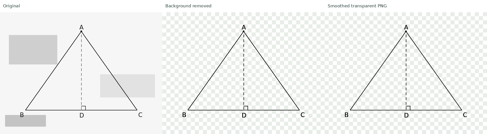

# 线稿净化小实验

独立运行，不修改现有网页、手动上传或豆包流程。只依赖项目已有的 Pillow 与 NumPy，无模型、API、服务器或桌面控制。

流程：按亮度阈值保留深色像素 → 背景 alpha 置零 → 仅平滑 alpha 蒙版边缘 → 输出黑色或指定单色线稿的透明 PNG。

合成样例，左为原图，中为去背景，右为平滑后的透明线稿（棋盘格仅用于预览）：



Windows PowerShell，在项目根目录运行内置样例：

```powershell
.\.venv\Scripts\python.exe experiments\line_cleanup.py demo
```

处理你自己的截图：

```powershell
.\.venv\Scripts\python.exe experiments\line_cleanup.py run "D:\截图.png" --threshold 170 --smooth 0.5
```

Mac / Linux 将 `.\.venv\Scripts\python.exe` 换成 `.venv/bin/python`，路径改用 `/`。

每次默认生成独立目录 `experiments/output/<随机编号>/`，包含原图、去背景图、平滑后透明 PNG、三图对比和耗时 JSON。运行结束显示目录路径。可用 `--output-dir "D:\line-test-1"` 指定目录，已有同名结果时停止，避免覆盖。

参数：

- `--threshold 170`：0–254。低于或等于此亮度的像素保留。调低会删除更多灰色，但可能丢掉淡字、虚线；调高保留更多细节，也可能留下深灰背景块。
- `--smooth 0.5`：0–2 像素，0 关闭。仅平滑透明度边缘，不是几何重建、直线拟合或矢量化。较大值会让细线变淡、窄缝变小，建议 0.3–0.6。
- `--ink "#1565c0"`：指定单一输出颜色，默认黑色。暂不自动识别或保留多种主体颜色。

默认不删小连通域、不补线、不膨胀，以保护字母点、顶点和虚线。阈值法无法区分亮度相同的灰色杂块与浅色线条，也无法恢复原图丢失的结构，这是本次实验要用真实截图验证的限制。先在原尺寸处理，不做倍数放大，最多 1200 万输入像素。

耗时分开报告阈值/去背景、蒙版平滑、纯计算与计算加导出。读取文件时间不含在计算/导出计时中。demo 还在 100 万及 400 万像素合成图上分别测三次纯计算耗时，不包括样例生成、文件读写或网络传输。实际耗时依电脑和截图内容而定。

验证：

```powershell
.\.venv\Scripts\python.exe -m unittest experiments.test_line_cleanup -v
```
